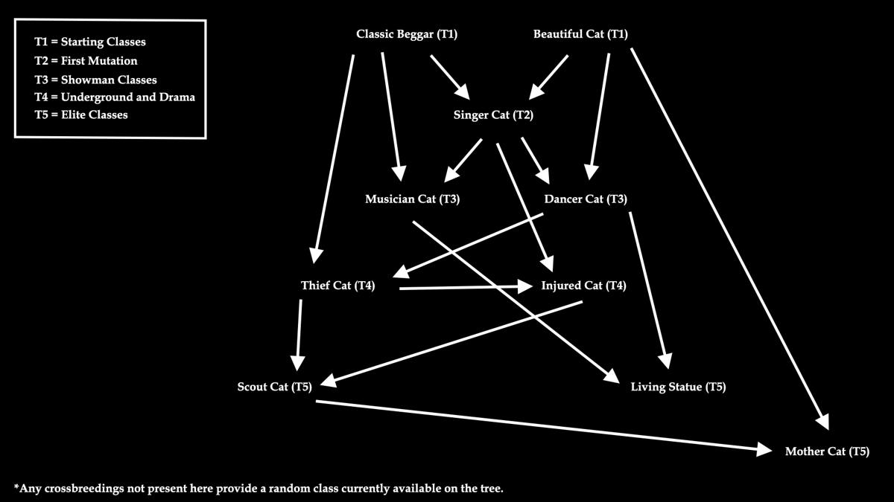

# Meowtro — Game Design Overview

> **Design intent, not a shipping feature list.** This summarizes the university concept described in the 2026 `İncirli Station` report. Individual systems can be represented in the Unity prototype without the overall game being complete.

## High concept

The player controls the Boss Cat who directs an underground gang of metro cats at Istanbul's İncirli Station. The Boss Cat delegates work rather than begging. Cats are stationed at high-traffic areas, obtain food from commuters, and return value to the group. Strategic decisions concern staffing, breeding, food investment, public attention and security risk.

## Intended daily loop

1. **Morning / planning:** Choose cats for nodes such as turnstiles, ticket booths and tunnels; select tools or supplies.
2. **Day / observation:** Commuters travel through the station; cats use class-dependent tactics to receive food. Watch station pressure, use resources and rearrange assignments.
3. **Daily report:** Review dry food, wet food, dried meat, and **Aç Bitir**, as well as upkeep and lost cats.
4. **Long-term progression:** Breed cats, improve the roster, unlock specialized roles and obtain better tools from the kiosk.
5. **Repeat:** Account for security and station events before the next shift.

## Cat roles

| Proposed role | Function |
| --- | --- |
| Classic Beggar / Vendor | Basic, relatively steady income |
| Singer | Attracts passers-by by singing |
| Musician | Uses makeshift instruments to keep a crowd |
| Injured / Guilt Trip | Plays on sympathy for higher donations |
| Beautiful / Hypnosis | Gains food by drawing attention |
| Thief / Heist | Targets rare items from passers-by |
| Scout / HR | Recruits additional cats |
| Living Statue | Performs as a silver-painted mime |
| Dancer | Entertains at busy nodes |
| Mother Cat | Supports kitten development at the cat tree |

This is a **design taxonomy** from the report. Do not interpret it as ten fully playable abilities.

## Class evolution & breeding

The proposed breeding system combines parent class inheritance with mutation and rarity. The Unity prototype contains coded class recipes, randomized inheritance, stat variation, dual-class cats and a special outcome when both parents share identical classes. The associated source is [`CatBreeding.cs`](../Assets/Scripts/CatBreeding.cs).

Some examples from the code's recipe table:

- Classic Beggar + Beautiful Cat → Singer Cat
- Classic Beggar + Singer Cat → Musician Cat
- Beautiful Cat + Singer Cat → Dancer Cat
- Dancer + Musician → Living Statue
- Scout + Beautiful → Mother Cat

**Important:** These are eligible mutation outcomes in the prototype logic, not guaranteed products of each pairing. The repository also defines random alternatives and fallback behavior.

The broader design additionally proposes feeding and raising kittens over time, mother-cat assistance, food-quality effects and a purity advantage. Those broader balancing/production mechanics are **not established as complete** by the source inspection.

### Stats and tactical placement

The concept document highlights pitifulness, diligence, cuteness and meowing. The Unity prototype's `CatStats.cs` defines a larger working set: efficiency, cuteness, charisma, meowing, rhythm, acting, sleight of paw and nurturing. These are **different iterations of the design**, not an exact one-to-one match.

Placement nodes are conceived for turnstiles, ticketing areas and tunnels. Code in the repository demonstrates placement/inventory interactions and passenger routing, but does not establish the full node-based income and commuter-demographics simulation.

## Food economy & risk

**Four proposed currencies/resources:** dry food, wet food, dried meat and Aç Bitir. The intended economy has ordinary resource upkeep, better food for breeding and rarer items for high-value exchanges.

- **Kiosk dog / black market:** Trade premium food for class equipment (microphones, silver paint, bandages, etc.) and support consumables.
- **Commuters:** Different demographic groups are proposed to yield different resources.
- **Odor/heat system:** A risk meter pressures players to manage where cats congregate.
- **Dynamic events:** Security raids, holiday rushes and a visiting merchant cat add variability.
- **Time:** Planned 2× and 3× speeds, with tradeoffs to ending shifts early.

These sections are design proposals in the report; they are **not verified shipped gameplay**.

## Design challenges explored

1. **Readable complexity:** Communicating a class tree, two possible inherited classes, eight implementation stats and multiple resources through UI.
2. **Systems interaction:** Making breeding decisions affect staffing and resource yield instead of functioning as a standalone minigame.
3. **Spatial strategy:** Using metro entrances, commuter routing and placement slots to make location matter.
4. **Risk / reward:** Balancing efficient gathering, cat upkeep and station-security pressure.

## Visual development

The submission includes reference photos of İncirli, low-poly environment models, cat variations, Unity greyboxing and UI experiments. Images in [`PortfolioMedia/`](PortfolioMedia/) are extracted from the team's academic progress report; see [credits and provenance](CREDITS_AND_MEDIA.md).

This design document is a **portfolio-friendly synthesis of the original concept**, not a claim that the game has been completed or released.
