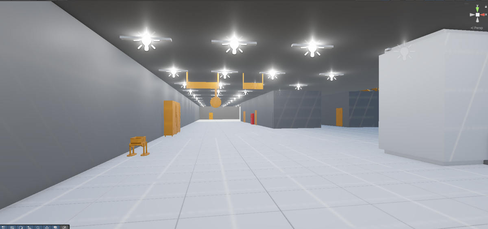
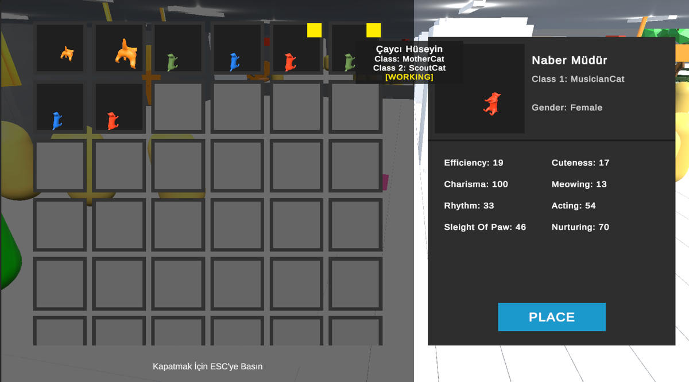
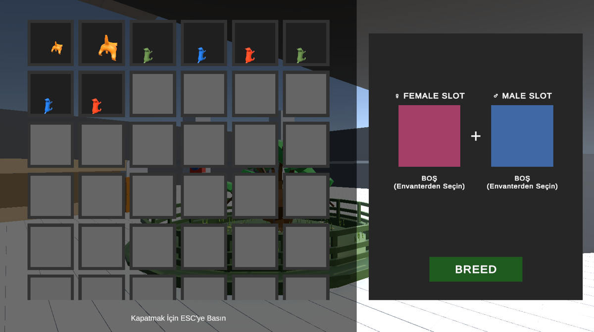
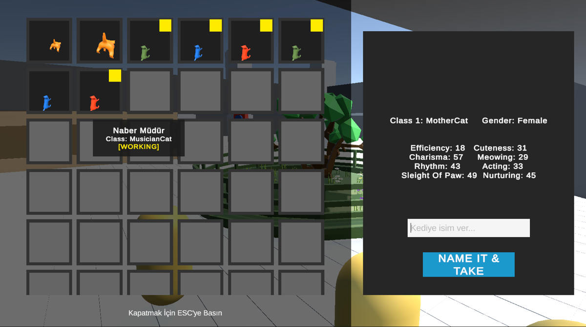
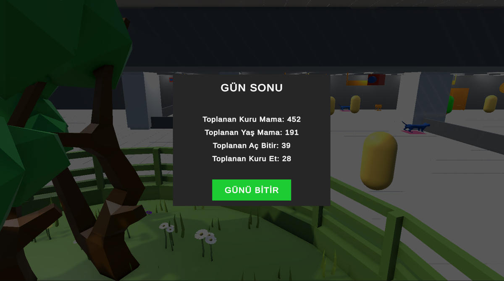
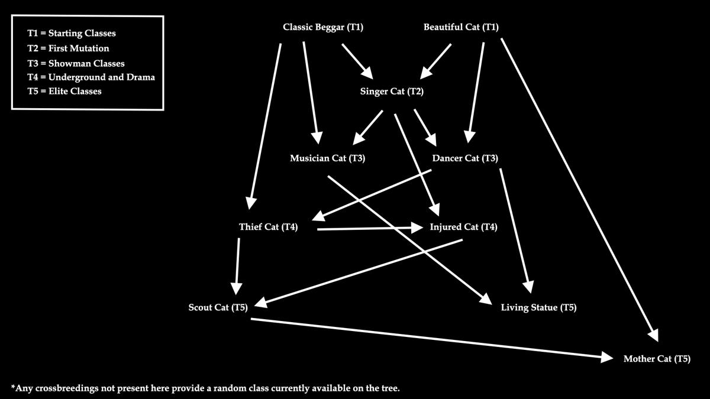
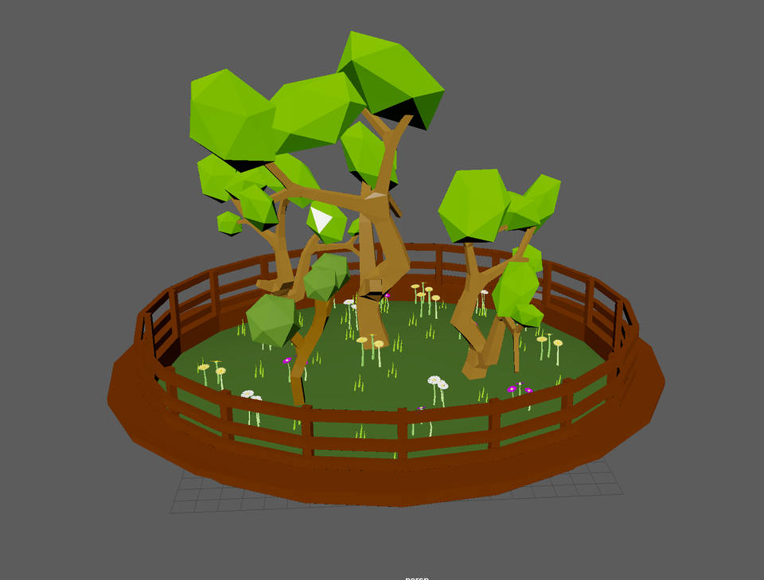
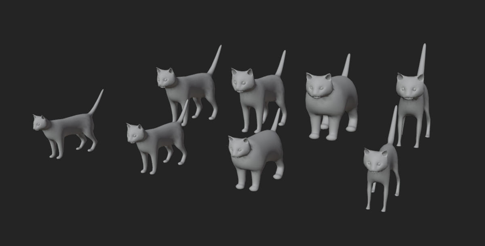
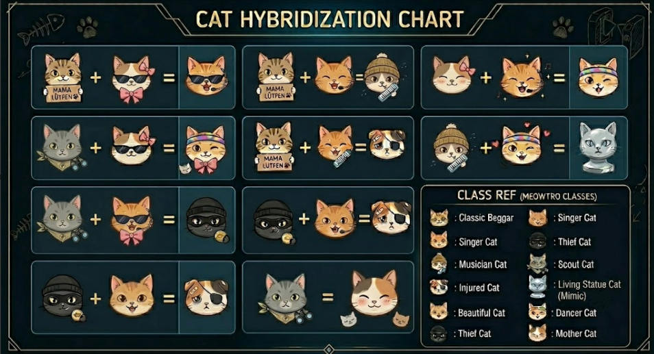

# MEOWTRO 🐈‍⬛🚇
### Game Design Concept · Unity Systems & Greybox Prototype

**Lead concept and Unity prototyping project | Academic team project (2026)**

> **Project status — Concept / proof of concept, not a finished game.** Meowtro was developed for a university game design assignment: devise an original game concept, communicate its systems, model an environment, and demonstrate selected mechanics in Unity. The visuals below intentionally show greyboxing, experimental UI, and early 3D assets, **not** a polished or released game.

  

## The pitch

**What if the cats of an Istanbul metro station ran their own underground food empire?**

In **Meowtro**, the player is the **Boss Cat** managing a gang based around the İncirli Station cat tree. Assign cats to strategic commuter routes, collect different food resources, breed cats to discover new classes and traits, and expand the operation while managing upkeep and the risk of security intervention.

**Genre:** management / strategy / simulation concept · **Setting:** İncirli metro station, Istanbul · **Engine:** Unity 6 · **Prototype focus:** cat genetics, resource management, station AI, UI and greyboxing.

## The central loop (design proposal)

`Plan the day → Assign cats & equipment → Observe commuters and food yields → Manage risk & upkeep → Review day results → Breed / improve cats → Repeat`

The full proposed loop is documented in [the design overview](Docs/GAME_DESIGN.md). Not all components of this loop are present in the Unity prototype.

## Unity prototype evidence

These are **authentic development screenshots** taken from the university progress report, not final-game promotional art.

| Station greyboxing | Cat placement and inventory |
|:--:|:--:|
|  |  |
| Breeding selection | Newborn cat / stats |
|  |  |
| End-of-day prototype | Cat class progression diagram |
|  |  |

### Systems represented in source code

| Prototype area | Code evidence | Scope / limitation |
| --- | --- | --- |
| **Commuter navigation** | [`PassengerAI.cs`](Assets/Scripts/PassengerAI.cs), [`PassengerSpawner.cs`](Assets/Scripts/PassengerSpawner.cs) | NavMesh waypoint routes, chance-based detours, queue detection, recovery for stuck agents |
| **Cat class inheritance & mutation** | [`CatBreeding.cs`](Assets/Scripts/CatBreeding.cs), [`CatClassManager.cs`](Assets/Scripts/CatClassManager.cs) | Parent class inheritance, mutation recipes, stat variation and unlock tracking |
| **Breeding flow** | [`CatBreedingManager.cs`](Assets/Scripts/Breeding/CatBreedingManager.cs) | Parent selection, progress timer, newborn cat creation |
| **Cat stats & resources** | [`CatStats.cs`](Assets/Scripts/CatStats.cs), [`FoodManager.cs`](Assets/Scripts/Inventory/FoodManager.cs) | Cat attributes and prototype food accumulation; simplified versus proposed commuter-specific economy |
| **Cat inventory / placement** | [`CatInventoryManager.cs`](Assets/Scripts/Inventory/CatInventoryManager.cs), [`UIManager.cs`](Assets/Scripts/UI/UIManager.cs) | Inventory, place/remove actions, info panels, breeding UI and day-summary panel |

**Verification boundary:** The table describes code present in the repository and supporting screenshots in the report. The project has **not** been freshly opened, compiled or playtested for this portfolio update; these descriptions do not guarantee a stable end-to-end playable build. See [prototype scope](Docs/PROTOTYPE_SCOPE.md).

## Design exploration

| Gathering tree model | Cat variation models | Illustrative hybridization concept |
|:--:|:--:|:--:|
|  |  |  |

*The hybridization illustration is an AI-assisted visual concept, **not an implemented in-game UI**. Other screenshots show actual development work.*

## What I worked on

**Ali Rıza Kabataş — Game concept, systems design, Unity development and technical prototyping.**

My documented contributions include metro scene layout/greyboxing, commuter AI and camera experiments, cat breeding and class/stat systems, inventory and placement UI prototypes, and day/event summary experiments. As a team concept project, work by collaborators is credited below. This repository should be read as evidence of **systems thinking, rapid prototyping, and communicating a complex game idea**, rather than a completed commercial title.

## Team & context

Academic team **Dümenzii** — Ali Rıza Kabataş, Arda Doğruel, Berat Demirel, and Yavuz Kaan Gezgin. The course report documents modelling contributions and additional cat UI / crossbreeding mockups by teammates. See [project credits](Docs/CREDITS_AND_MEDIA.md) for attribution and media provenance.

## Explore the project

- **[Game design overview](Docs/GAME_DESIGN.md)** — concept, loop, classes, progression, economy and risks.
- **[Prototype scope & technical notes](Docs/PROTOTYPE_SCOPE.md)** — what has code/screenshot evidence versus what remains conceptual.
- **[Media & attribution](Docs/CREDITS_AND_MEDIA.md)** — team contributions and source pages of all portfolio images.
- Unity project source is retained in [`Assets/`](Assets/), [`Packages/`](Packages/) and [`ProjectSettings/`](ProjectSettings/); the tracked editor version is **6000.0.41f1**.

### Exploring the Unity files

Clone the repository and open it in Unity Hub with **Unity 6000.0.41f1** (the version recorded in `ProjectSettings/ProjectVersion.txt`). The tracked build settings point to `Assets/Scenes/AiSystem.unity`; `Assets/Scenes/Metro.unity` is also available. Expect incomplete prototype tooling/scene references and possible import or package issues. This source snapshot is supplied for **inspection**, not as a tested release.

---

*Portfolio presentation assembled from the team's 2026 design submission and existing Unity code. The work shown is explicitly an academic concept and greybox prototype.*
